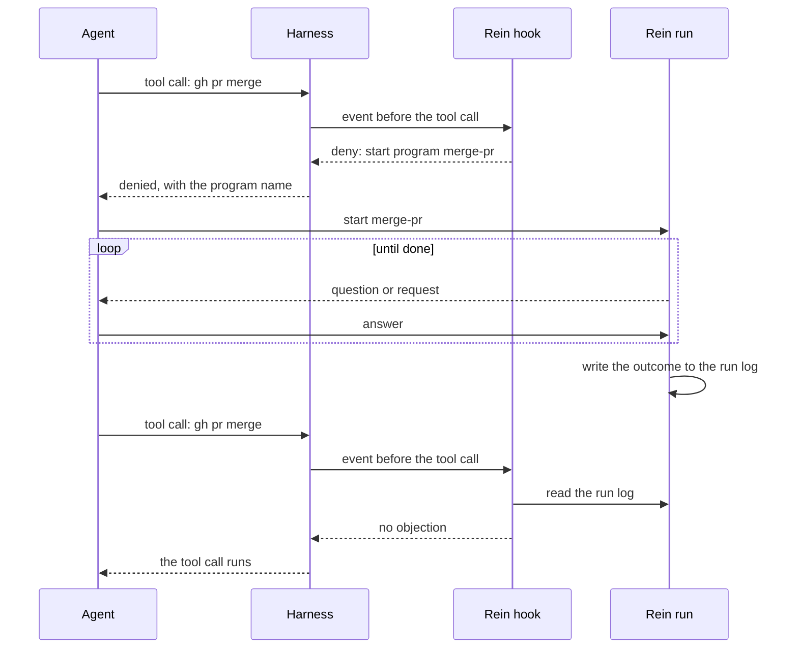

# Agent interface: proposal

Status: proposal. Not decided. No code implements it.
The current rules are in [spec.md section 11](spec.md#11-stepping-agent-interface) and [section 12](spec.md#12-agent-integration). The reasons for the current choices are in [decisions.md](decisions.md).

The built interface is in [interface.md](interface.md): the MCP host, `rein run`, and programs as named apps. This file proposes what comes next.

## Principle

The agent is the sensor and the actuator. The runtime is the memory, the fact reader, and the gate.

| Job | Owner |
| --- | --- |
| Judge what it sees (an answer) | Agent |
| Do a step (a request) | Agent |
| Keep the answers of a run | Runtime |
| Read a fact that a command can read | Runtime |
| Stop a guarded action until the program allows it | Runtime |

With `rein step`, the agent has all five jobs. The MCP host moves the third job to the runtime while a run lives. The proposal moves the last three to the runtime, and keeps the state after a run ends.

## The interface today

| Contract | Today | Source |
| --- | --- | --- |
| Trigger | One context block on the first prompt. The agent decides when a task matches a program. | [hook.rs](../crates/rein/src/hook.rs) |
| Step | The MCP host keeps the answers of a live run in memory. `rein step` stays for replay, and there the agent sends every answer. | [interface.md](interface.md) |
| Answer source | The agent answers every question. | [decisions.md](decisions.md), last open question |
| Outcome | `done` holds free text. | [spec.md section 11](spec.md#11-stepping-agent-interface) |

## Findings

Measured on 2026-11-11 with the installed `rein 0.1.0`. The commit of that build is not known. On commit `9d65e21`, the test `reference_cycle_hits_the_hop_limit` in [step.rs](../crates/rein-core/src/step.rs) asserts the error of finding 1.

1. A reached reference cycle always ends in an error. An answer key is `<function>.<name>`, so a second visit gets the same answers and takes the same path. Run the `merge-pr` example with these answers:

   ```text
   $ rein step --root <merge-pr example> --json \
       --answer main.task=merge --answer merge_pr.docsOnly=no \
       --answer merge_pr.ci=red --answer ci/fix.fixPushed=yes
   {"kind":"error", ... "message":"flow did not finish in 64 steps (reference cycle?)", ...}
   ```

   The retry in the `merge-pr` example does not work. The same path fails in `rein-lang/pr-handling`.
2. On the CLI, a question exits with code 2 and a request exits with code 3. In Claude Code, the shell tool reports a non-zero exit code as an error. A normal result looks like a failure.
3. Nothing checks that the agent started a program or finished it. The hook gives advice only.
4. With `rein step`, the agent can change an earlier answer between two calls. The runtime cannot see the change, because it keeps nothing.
5. With `rein step`, each call repeats every answer. The command grows with the program, and the agent must copy each key exactly.

## Proposal: four contracts

### 1. Trigger: attach a program to an action

A program can have one of three trigger levels.

- Advise. The program is in the context of the agent. This is the level today.
- Gate. The program names the action it guards, such as the shell command `gh pr merge`.
- Event. A caller outside the agent starts the run, such as an alert or a schedule. The first step is the prompt of the agent.

For a gate, the hook listens to the event before a tool call. When no run has an allowing outcome, the hook denies the call. The denial text names the program to start.



Reasons:

- The agent needs no judgement to start the program. It meets the gate at the moment that matters.
- The context cost is zero until the gate fires.
- The gate works for every session that makes the tool call.

A limit: the hook must answer with a denial or with nothing. An approval skips the user's permission prompt. The comment at the top of [hook.rs](../crates/rein/src/hook.rs) gives this reason.

### 2. Step: the run keeps the answers

The MCP host already does the first part: a run has an id, and the host keeps its answers. The core stays pure: `step(project, answers)`. Two parts are not built:

- The run writes an append-only log to disk: one line for each answer, then the outcome. The hook is a different process, so it can read a run only from disk. A live run in memory is also lost when the host exits.
- An answer names the key it answers. A value for a different key is an error. This guards against two answers that an agent sends at the same time.
- The response does not repeat every answer.

For cycles, choose one of these:

- Give each visit of a function its own answers. A cycle then asks again, and a retry works.
- Make a reached cycle a checker error. A retry ends the run with the text "run the program again".

### 3. Answers: three sources

Each question names who answers it.

| Source | Who answers | Use |
| --- | --- | --- |
| `agent` | The agent, from what it sees. | Judgement, such as "is this change risky?" |
| `probe` | A command that the runtime runs. | Facts, such as the CI status. |
| `user` | The user only. | Approval, such as "may I deploy?" |

- A probe needs no agent turn. A program that reads its facts with probes asks fewer questions.
- A probe needs a program input, such as the pull request number. Program inputs are built ([spec.md section 4](spec.md#4-declarations)). Probes are still a proposal. An input is a `string`. It goes into templates and probes only, and never into a condition.
- The response for a `user` question says so. The harness can then use its own ask dialog, and the agent must not answer.

### 4. Outcome: a verdict that a gate can read

- `done` gets a status next to its text: allow or block. A std template such as `allow("...")` can set it.
- A gate opens only on an allow, and only one time.
- The run log and the outcome are the audit record of the decision.

## State between runs

Owner direction, 2026-11-11: the program holds the state, like a computer app. A user of an app does not enter everything again for each action.

Contract 2 covers one run. This section covers what stays after a run ends.

The state hangs on a subject, such as one pull request. A subject is like a document in an app. A run starts with its subject, and a later run on the same subject continues from the stored state.

The subject of a run is a program input, such as the pull request link. The caller passes it as a `string` parameter ([spec.md section 4](spec.md#4-declarations)).

Not all state is equal:

| Kind | Example | Rule |
| --- | --- | --- |
| An answer that the agent or the user gave | "Does the PR change permissions code?", "May I merge?" | Remember it. Ask one time. |
| A fact of the world | The CI status, the review state | Do not remember it. Read it again on each run. |
| Progress | The open step, the number of retries | Remember it. |

An app works the same way. It keeps what the user typed, and it loads the inbox again.

Effects on the `pr-handling` example:

- After a pushed CI fix, the next run does not ask for the draft state or the task again.
- "Run the failed job again, one time" becomes a rule. The program can count the retries.
- A retry is new progress, not a second visit with old answers. Finding 1 does not occur.

The core stays pure. The state is the run log of the subject, and a step is a function of that log.

Recommended place for the state: the state folder of the user, with one file for each repo and subject. Reasons:

- The hook and every session on the machine can read it.
- Nothing goes into git, and a cloned repo brings no state with it.

A limit: a second machine does not see the state. State that lives with the subject, such as on the pull request, can solve that later.

A stored answer can become wrong. A new commit can add permissions code after the agent answered "no". An answer needs a rule for when it expires.

Recommended expiry rule: an answer about the content of the subject expires when the content changes. For a pull request, that is a new head commit. An approval from the user expires the same way. Progress does not expire.

## Worked example: merge-pr

This section walks the `merge-pr` example through the four contracts. It shows the idea only. No syntax is decided.

The path is a code change with green CI. Today the agent makes five `rein step` calls on this path.

| Step | Today | With the four contracts |
| --- | --- | --- |
| Start | The agent must recall that the program exists. | The agent calls `gh pr merge 42`. The gate denies the call and names `merge-pr`. |
| `main.task` | The agent answers `merge`. | No question. The guarded action is the merge, so the gate starts the run at `merge_pr`. |
| `merge_pr.docsOnly` | The agent answers. | The agent answers. |
| `merge_pr.ci` | The agent reads the CI status and answers. | A probe runs `gh pr checks 42`. The agent gets no question. |
| `review_code.securitySensitive` | The agent answers. | The agent answers. |
| End | `done` with free text: delegate a code review. | A request: the program waits for the review result, then returns a status. |

Today the agent answers four questions on this path. With the contracts it answers two.

Each end of the program gets a status:

| End today | With contract 4 |
| --- | --- |
| `"approved"` | Allow. The gate opens for one merge call. |
| `"wait for CI, then run merge_pr again"` | Block. The gate stays closed. |
| Delegate a code review | The program cannot end here. A gate needs a verdict, so the review becomes a request. |
| `ci/fix` with a pushed fix | Finding 1 today. The result depends on the cycle choice in contract 2. |

Notes:

- A probe can also answer `docsOnly`, because a command can list the changed files.
- The example has no approval question. A program can add one with the `user` source, such as "May I merge?".
- The probe needs the pull request number. The denied command holds it.

## Worked example: incident-triage

The path is a sev2 alert with no customer impact and a known runbook. Today the agent makes five `rein step` calls on this path.

| Step | Today | With the four contracts |
| --- | --- | --- |
| Start | The agent must recall that the program exists. | The alert starts the run. The first step is the prompt of the agent. |
| `main.customerImpact` | The agent answers. | The agent answers. |
| `main.severity` | The agent answers. | A probe reads the severity from the alert. |
| `main.knownRunbook` | The agent answers. | A probe looks for the runbook file. |
| Approval | None. | A `user` question: "May I run the runbook steps?" The example has no such question today. |
| `runbook/follow.fixed` | The agent runs the steps, then answers. | The agent runs the steps. A probe reads the alert status. |
| End | `done` with free text: close the alert. | Allow, for a gate on the close action. |

Today the agent answers three questions and one request on this path. With the contracts it answers one question and does one request.

This example adds three points:

- A program that routes an event has no first action to guard. It needs the event trigger level.
- A probe can answer a request. The agent does the step, and the runtime checks the result.
- `page_human` ends with the text "Wait for an acknowledgement". That text is advice today. A request can hold the run until the acknowledgement.

## Transport

The four contracts do not depend on the transport. The step objects stay the same.

| Transport | Good for | Limit |
| --- | --- | --- |
| MCP host | An agent in a harness. The tools have types. There are no exit codes and no shell quoting. | Each tool costs context. A harness with many tools can hide them until the agent searches. |
| CLI | Scripts, CI, and a harness with no MCP. | Finding 2 and finding 5. |

For an MCP host:

- Give the agent three tools: list the programs, start a run, answer a step. Keep the status, stop and list-runs tools for the operator, on the CLI.
- Use the server instructions for the advise level. They can replace the first-prompt context block.
- Runs that live only in memory are lost when the host exits, and the hook cannot read them. The run log on disk solves both.

For the CLI in an agent mode: exit with code 0 for `question`, `request` and `done`. Only `error` is non-zero.

## What stays

- The pure core and the four response kinds.
- One function for each file, and the checker rules.
- The agent calls the program. The program never owns the loop.

## Order

Each step is usable without the next one.

1. The run log on disk and the key guard, on top of the MCP host.
2. State between runs: the subject, the three kinds, and the expiry rule.
3. The outcome status and one gate.
4. Probes and program inputs. Inputs are built; probes are not.

## Open questions

- Where does a program declare its gate: a doc tag in `main.rein`, or the manifest?
- Cycles: answers for each visit, or a checker error?
- How does the hook match a run to a session? The hook can record the run id from the event after the start tool call. A weaker match is the working directory.
- State: when does the state of a subject end? For a pull request, merged or closed is the likely end.
- State: how does a program declare the kind of each question: remember, or read again?
- Trust: a probe runs a command from a program file. Does a project-scope program from a cloned repo need consent first?
- Contract 4 opens a gate one time. Does a failed tool call need a second try without a new run?
- How does a gate pass a value from the guarded command to the run, such as the pull request number?
- Does the source of a program belong in the agent's tools? An agent that reads the source can pick answers for the outcome it wants.
- Not verified: does the first-prompt context reach a subagent? A gate does not depend on the answer.
