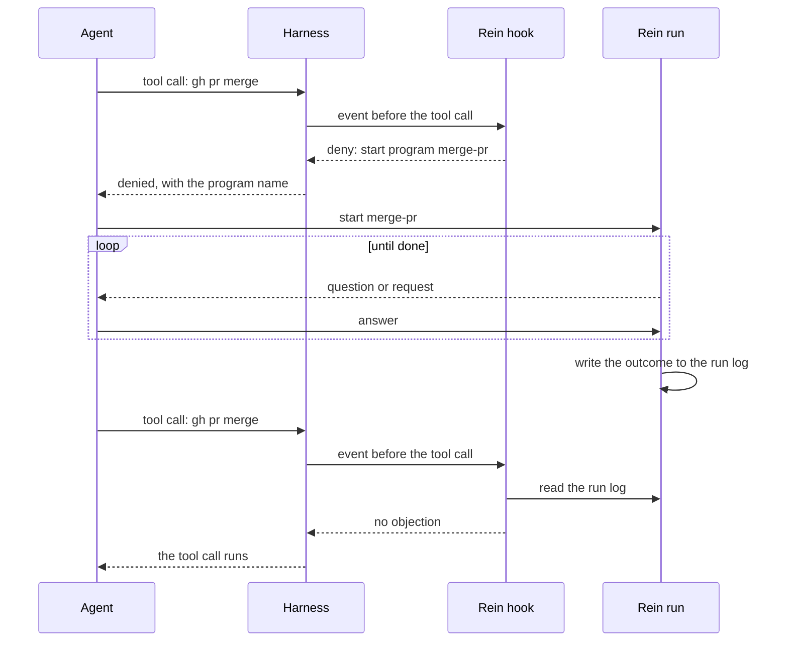

## Proposal: four contracts

### 1. Trigger: attach a program to an action

A program can have one of three trigger levels.

- Advise. The program is in the context of the agent. This is the level today.
- Gate. The program names the action it guards, such as the shell command `gh pr merge`.
- Event. A caller outside the agent starts the run, such as an alert or a schedule. The first step is the prompt of the agent.

For a gate, the hook listens to the event before a tool call. When no run has an allowing outcome, the hook denies the call. The denial text names the program to start.

Reasons:

- The agent needs no judgement to start the program. It meets the gate at the moment that matters.
- The context cost is zero until the gate fires.
- The gate works for every session that makes the tool call.

A limit: the hook must answer with a denial or with nothing. An approval skips the user's permission prompt. The comment at the top of [hook.rs](../../crates/rein/src/hook.rs) gives this reason.
