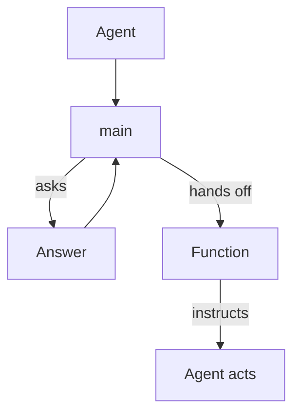

# Concepts

Rein describes an agent process as a set of small functions. Each function is one file. The functions reference each other by path. Together they tell the agent what to do next, one step at a time.

## The agent drives the process

Rein does not run the agent. The agent starts a program with the `rein_start` MCP tool, or with `rein run`, and answers it one step at a time. The program holds its state while it runs. The agent does each step it is given. See [Evaluation](/reference/spec#_9-evaluation) for what a run returns.

## Functions are files

A project holds one function per file, and the file path gives the function its name. The entry point is always `main`. A function describes itself in a doc comment. Every input carries a question of its own, which the agent reads before it answers. See [Declarations](/reference/spec#_4-declarations).

## Functions hand off by reference

A function ends in text for the agent, a reference to another function, or a call to a template that builds text. An import names another function by its path from the current file, as `import { fix } from "./fix";`. See [Imports](/reference/spec#imports) and [Templates](/reference/spec#templates).

## Inputs are typed questions

An input is a boolean or a choice of strings. Rein asks for an input only when the path it is on needs that input. Inputs look like TypeScript parameters, so they are easy to read. The agent gets one step at a time. [Progressive disclosure](/progressive-disclosure) explains why. See [Parameters](/reference/spec#parameters) and [Conditions](/reference/spec#_6-conditions).

## Requests wait for the agent

Some steps ask the agent to act first. The agent does the step, gives the answer, and the process goes on. A live run holds its answers. With `rein step`, Rein keeps no state: each call takes every answer so far. See [Async requests](/reference/spec#async-requests).

## Strict by design

Rein favors explicit cases over fallbacks. The checker reports a missing case, or a path with no result, before a run starts. The rules live in the [checker section](/reference/spec#_8-checker-rules). The reasons for these choices live in [Decisions](/reference/decisions). For why Rein is its own small language, see [Why not an existing language](/why-not-a-programming-language).

## Rein and skills

A skill gives the agent knowledge. A process gives the agent the next step. See [Rein and skills](/rein-vs-skills) for the use cases of each.
