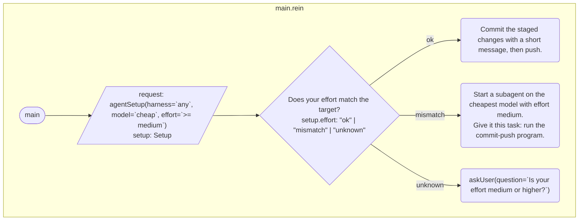

# commit-push

A program that commits the staged changes and pushes them. It runs best on
the cheapest model, and it needs medium effort or more. It asks the agent for
its setup first with the std function `agentSetup`, and sends a subagent when
the effort does not match.

## Files

| File | Function | Job |
| --- | --- | --- |
| `main.rein` | `main` | Asks the setup. Effort ok: commit and push. Mismatch: send a subagent. Unknown: ask the user. |

## Run it

```sh
git clone https://github.com/rein-lang/examples
cd examples
rein check rein/commit-push
rein run --root rein/commit-push
```

## Graph

The decision flow, from `rein graph commit-push`:



## Source

### `package.json`

```json
{
  "name": "commit-push",
  "version": "0.1.0",
  "description": "Commit the staged changes and push them.",
  "license": "MIT",
  "private": true,
  "files": ["**/*.rein", "README.md", "rein.json"],
  "engines": {
    "rein": "^0.1.0"
  }
}
```

### `rein.json`

```json
{
  "entry": "main.rein"
}
```

### `main.rein`

```rein
/**
 * Commit the staged changes and push them.
 */
export default async function main() {
  /** Your setup. */
  const setup: Setup = await agentSetup(
    harness=`any`,
    model=`cheap`,
    effort=`>= medium`,
  );

  switch (setup.effort) {
    case "ok":
      return `Commit the staged changes with a short message, then push.`;
    case "mismatch":
      return `Start a subagent on the cheapest model with effort medium.
Give it this task: run the commit-push program.`;
    case "unknown":
      return askUser(question=`Is your effort medium or higher?`);
  }
}
```
