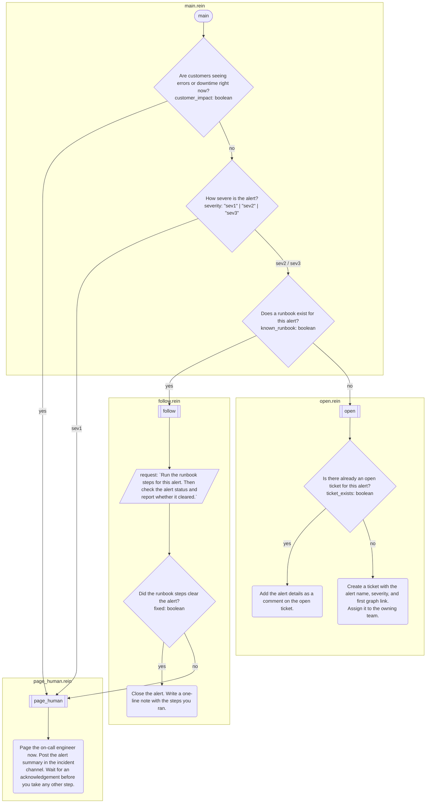

# incident-triage

An on-call agent process. It decides how to handle a new production alert.

The process asks three questions: how severe the alert is, whether customers feel it, and whether a runbook exists. Then it picks one of three outcomes: page a human, follow the runbook, or open a ticket.

## Files

| File | Function | Job |
| --- | --- | --- |
| `main.rein` | `main` | Entry point. Routes the alert. |
| `page_human.rein` | `page_human` | Pages the on-call engineer. |
| `follow.rein` | `follow` | Asks the agent to run the known runbook and report whether the alert cleared. Pages a human if it did not. |
| `open.rein` | `open` | Opens or updates a ticket for non-urgent alerts. |

## Run it

```sh
git clone https://github.com/rein-lang/examples
cd examples
rein check rein/incident-triage
rein run incident-triage
```

## Graph

The decision graph, from `rein graph incident-triage`:



## Source

### `package.json`

```json
{
  "name": "incident-triage",
  "version": "0.1.0",
  "description": "Decide how the on-call agent handles a new production alert.",
  "license": "MIT",
  "private": true,
  "files": ["**/*.rein", "README.md", "rein.json"],
  "engines": {
    "rein": "^0.1.0"
  }
}
```

### `rein.json`

```json
{
  "entry": "main.rein"
}
```

### `main.rein`

```rein
import { page_human } from "./page_human";
import { follow } from "./follow";
import { open } from "./open";

interface Alert {
  /** How severe is the alert? */
  severity: "sev1" | "sev2" | "sev3";
  /** Are customers seeing errors or downtime right now? */
  customer_impact: boolean;
  /** Does a runbook exist for this alert? */
  known_runbook: boolean;
}

/**
 * Decide how the on-call agent handles a new production alert.
 */
export default function main({
  severity,
  customer_impact,
  known_runbook,
}: Alert) {
  if (customer_impact) {
    return page_human;
  }

  switch (severity) {
    case "sev1":
      return page_human;
    case "sev2":
    case "sev3":
      if (known_runbook) {
        return follow;
      }

      return open;
  }
}
```

### `follow.rein`

```rein
import { page_human } from "./page_human";

/**
 * Follow the runbook for an alert that has one.
 */
export default async function followRunbook() {
  /** Did the runbook steps clear the alert? */
  const fixed: boolean = await request(
    `Run the runbook steps for this alert. Then check the alert status and
    report whether it cleared.`,
  );

  if (fixed) {
    return `Close the alert. Write a one-line note with the steps you ran.`;
  }

  return page_human;
}
```

### `open.rein`

```rein
/**
 * Open a ticket for an alert that needs follow-up but no page.
 */
export default function openTicket(
  /** Is there already an open ticket for this alert? */
  ticket_exists: boolean,
) {
  if (ticket_exists) {
    return `Add the alert details as a comment on the open ticket.`;
  }

  return `Create a ticket with the alert name, severity, and first graph link.
  Assign it to the owning team.`;
}
```

### `page_human.rein`

```rein
/**
 * Page the on-call engineer for an alert that needs a human now.
 */
export default function pageHuman() {
  return `Page the on-call engineer now. Post the alert summary in the incident
  channel. Wait for an acknowledgement before you take any other step.`;
}
```
