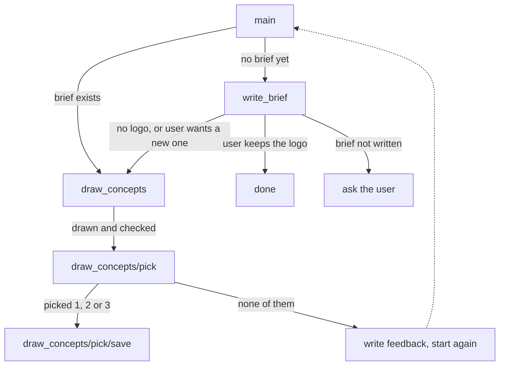

# logo-creation


The program made this logo in its first real run, on its own repo.

A published program that creates a logo for a project. It lives in its own repo, [rein-lang/logo-creation](https://github.com/rein-lang/logo-creation), not in `examples/rein/`. Use it as a model for a program you share.

The agent writes a brief, and a subagent draws three SVG concepts. A script checks the concepts. The user picks one. The agent saves the logo files to `assets/` and adds the logo to the README.

## Files

| File | Function | Job |
| --- | --- | --- |
| `main.rein` | `main` | Entry point. Resumes from `.logo/brief.md` when an earlier run wrote it. |
| `write_brief.rein` | `write_brief` | Reads the project and writes the brief. Asks before it replaces a logo. |
| `draw_concepts.rein` | `draw_concepts` | A subagent draws three concepts. `scripts/check-svg.sh` checks them. |
| `draw_concepts/pick.rein` | `draw_concepts/pick` | `scripts/preview.sh` renders the concepts. The user picks one. |
| `draw_concepts/pick/save.rein` | `draw_concepts/pick/save` | `scripts/export.sh` saves the logo files. |

## What it shows

- **Bundled scripts.** Each shell step is a script in `scripts/`, listed in `files` in `package.json`. A request names the script and its arguments. See [Install a program](/install-programs).
- **A script as a gate.** The agent runs `check-svg.sh` and answers `valid: boolean`. The process goes on only on yes.
- **Rules in code.** Typed answers pick each branch, such as `info.logo == "has a logo"` in `write_brief`.
- **A subagent hand-off.** `draw_concepts` gives the drawing to a subagent with `delegate`.
- **A retry without a cycle.** On "none of them", the agent saves the feedback to `.logo/feedback.md` and starts the program again. `main` finds the brief and goes to `draw_concepts`.
- **Names.** Each file except `main` is a snake_case imperative verb. A function with one caller sits in a folder named after the caller, such as `draw_concepts/pick`. A function that only the entry calls stays at the root, such as `write_brief`. See [Project layout](/reference/spec#_1-project-layout).

## Run it

```sh
rein install -g "github:rein-lang/logo-creation#<commit sha>"
rein step logo-creation --input project=<path to the project>
```

The scripts need `rsvg-convert`, ImageMagick 7 (`magick`) and `xmllint`.

## Graph



## Source

The source lives in [rein-lang/logo-creation](https://github.com/rein-lang/logo-creation): the `.rein` files, `scripts/` and `package.json`. This page does not copy it, so it cannot drift.
