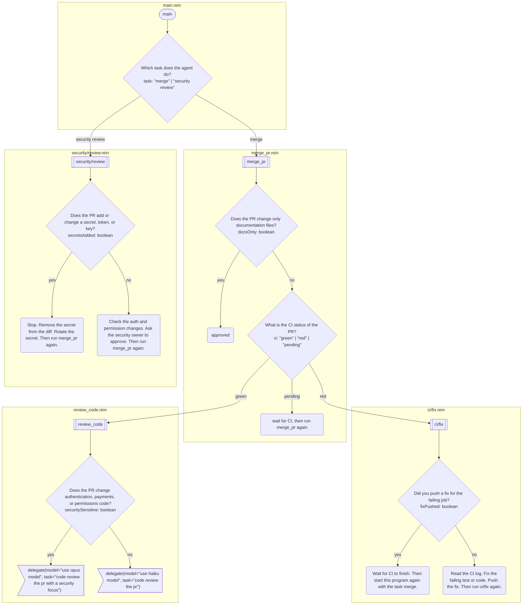

<!--@include: ../../../examples/rein/merge-pr/README.md-->

## Graph

The decision flow, from `rein graph merge-pr`:

## Source

### `rein.json`

<<< ../../../examples/rein/merge-pr/rein.json{json}

### `main.rein`

<<< ../../../examples/rein/merge-pr/main.rein{rein}

### `ci/fix.rein`

<<< ../../../examples/rein/merge-pr/ci/fix.rein{rein}

### `merge_pr.rein`

<<< ../../../examples/rein/merge-pr/merge_pr.rein{rein}

### `review_code.rein`

<<< ../../../examples/rein/merge-pr/review_code.rein{rein}

### `security/review.rein`

<<< ../../../examples/rein/merge-pr/security/review.rein{rein}
