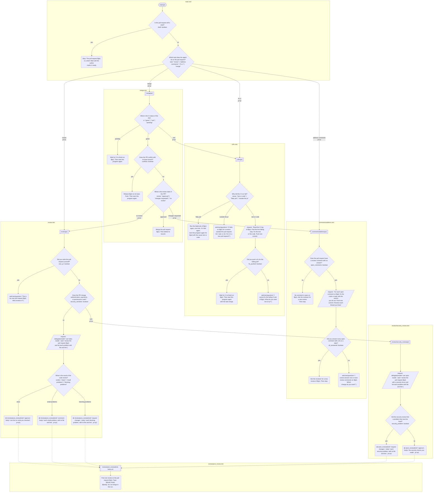

# pr-handling

A pull request agent program. It decides the next step for one pull request: review it, answer its comments, fix its CI, or merge it. The program takes the pull request link as its input `pr`.

The program stops on a draft. The merge task checks CI, conflicts and the review state, in that order. It hands the agent to the fix, the comments or the review when one of them blocks the merge. A review never merges in the same run.

The program has no reference cycle. A retry ends the run with the text "start this program again".

## Files

| File | Function | Job |
| --- | --- | --- |
| `main.rein` | `main` | Entry point. Stops on a draft. Routes by task. |
| `review.rein` | `review` | Delegates the review to a subagent. Posts one review from the result. |
| `comments/address.rein` | `comments/address` | Asks the agent to answer each open comment. |
| `ci/fix.rein` | `ci/fix` | Routes a failed CI run by its cause. Asks the agent to push a fix. |
| `merge.rein` | `merge` | Merges when CI is green, no conflict exists, and the review approves. |
| `review/post_review.rein` | `review/post_review` | A template: one review with a type and a body. `review` calls it. |

Each function gets `pr` from its caller and passes it on. There is no global scope.

## Run it

```sh
rein check examples/rein/pr-handling
rein step --root examples/rein/pr-handling --input pr=https://example.com/pr/1 --json
```

## Sample walk

The merge task on a pull request that is ready. Each call after the first repeats the input and the earlier answers. `...` stands for them. Each output line shows part of the JSON.

```text
$ rein step --root examples/rein/pr-handling --input pr=https://example.com/pr/1 --json
{"kind": "question", "key": "main.draft", "description": "Is the pull request still a draft?", "trace": ["main"]}
# exit 2

$ rein step ... --answer main.draft=no
{"kind": "question", "key": "main.task", "options": ["review", "address comments", "fix ci", "merge"], "description": "Which task does the agent do on the pull request?", "trace": ["main"]}
# exit 2

$ rein step ... --answer main.task=merge
{"kind": "question", "key": "merge.ci", "options": ["green", "red", "pending"], "description": "What is the CI status of the PR?", "trace": ["main", "merge"]}
# exit 2

$ rein step ... --answer merge.ci=green
{"kind": "question", "key": "merge.conflicts", "description": "Does the PR conflict with its base branch?", "trace": ["main", "merge"]}
# exit 2

$ rein step ... --answer merge.conflicts=no
{"kind": "question", "key": "merge.review", "options": ["approved", "changes requested", "no review"], "description": "What is the review state of the PR?", "trace": ["main", "merge"]}
# exit 2

$ rein step ... --answer merge.review=approved
{"kind": "done", "instruction": "Merge the pull request https://example.com/pr/1. Then delete its branch.", "trace": ["main", "merge"]}
# exit 0
```

## Graph

The decision flow, from `rein graph pr-handling`:



## Source

### `package.json`

```json
{
  "name": "pr-handling",
  "version": "0.1.0",
  "description": "Decide the next step for a pull request: review it, fix it, or merge it.",
  "license": "MIT",
  "private": true,
  "files": ["**/*.rein", "README.md", "rein.json"],
  "engines": {
    "rein": "^0.1.0"
  }
}
```

### `rein.json`

```json
{
  "entry": "main.rein"
}
```

### `main.rein`

```rein
interface Input {
  /** The link of the pull request to handle. */
  pr: string;
  /** Is the pull request still a draft? */
  draft: boolean;
  /** Which task does the agent do on the pull request? */
  task: "review" | "address comments" | "fix ci" | "merge";
}

/**
 * Decide the next step for a pull request: review it, fix it, or merge it.
 */
export default function main({ pr, draft, task }: Input) {
  if (draft) {
    return `Stop. The pull request ${pr} is a draft. Wait until the author
    marks it ready.`;
  }

  switch (task) {
    case "review":
      return @./review(pr=pr);
    case "address comments":
      return @./comments/address(pr=pr);
    case "fix ci":
      return @./ci/fix(pr=pr);
    case "merge":
      return @./merge(pr=pr);
  }
}
```

### `ci/fix.rein`

```rein
interface Input {
  /** The link of the pull request with the failing CI run. */
  pr: string;
  /** Why did the CI run fail? */
  cause: "test or code" | "flaky job" | "outside the pr";
}

/**
 * Fix a failing CI run on a pull request.
 */
export default async function fixCi({ pr, cause }: Input) {
  switch (cause) {
    case "flaky job":
      return `Run the failed job of ${pr} again, one time. If it fails again,
      start this program again for ${pr} with the cause test or code.`;
    case "outside the pr":
      return askUser(
        question=`CI fails on ${pr} for a reason outside this pull request.
        Do I wait, or do I fix it in a new pull request?`,
      );
    case "test or code": {
      /** Did you push a fix for the failing job? */
      const fix_pushed: boolean = await request(
        `Read the CI log of ${pr}. Find the first failing step. Fix the test
        or the code. Push one commit.`,
      );

      if (fix_pushed) {
        return `Wait for CI to finish on ${pr}. Then start this program again
        with the task merge.`;
      }

      return askUser(
        question=`I cannot fix the failing CI job of ${pr}. What do you want
        me to try?`,
      );
    }
  }
}
```

### `comments/address.rein`

```rein
interface Input {
  /** The link of the pull request with the review comments. */
  pr: string;
  /** Does the pull request have a review comment with no answer? */
  open_comments: boolean;
}

/**
 * Answer the open review comments on a pull request.
 */
export default async function addressComments({ pr, open_comments }: Input) {
  if (!open_comments) {
    return `No comment is open on ${pr}. Ask the reviewer for a new review.
    Then stop.`;
  }

  /** Did you answer every open comment with a fix or a reply? */
  const all_answered: boolean = await request(
    `For each open comment on ${pr}: fix the code or reply with the reason
    you do not. Push one commit. Resolve each thread you fixed.`,
  );

  if (all_answered) {
    return `Ask the reviewer for a new review of ${pr}. Then stop.`;
  }

  return askUser(
    question=`I cannot answer one or more review comments on ${pr}. Which
    change do you want?`,
  );
}
```

### `merge.rein`

```rein
interface Input {
  /** The link of the pull request to merge. */
  pr: string;
  /** What is the CI status of the PR? */
  ci: "green" | "red" | "pending";
  /** Does the PR conflict with its base branch? */
  conflicts: boolean;
  /** What is the review state of the PR? */
  review: "approved" | "changes requested" | "no review";
}

/**
 * Decide whether a pull request can merge now.
 */
export default function merge({ pr, ci, conflicts, review }: Input) {
  switch (ci) {
    case "red":
      return @./ci/fix(pr=pr);
    case "pending":
      return `Wait for CI to finish on ${pr}. Then start this program again.`;
    case "green":
      if (conflicts) {
        return `Rebase ${pr} on its base. Push. Then start this program again.`;
      }

      switch (review) {
        case "approved":
          return `Merge the pull request ${pr}. Then delete its branch.`;
        case "changes requested":
          return @./comments/address(pr=pr);
        case "no review":
          return @./review(pr=pr);
      }
  }
}
```

### `review.rein`

```rein
interface Input {
  /** The link of the pull request to review. */
  pr: string;
  /** Did you write this pull request yourself? */
  own_pr: boolean;
  /** Does the PR change authentication, payments, or permissions code? */
  security_sensitive: boolean;
}

/**
 * Review the code changes of a pull request and post the result.
 */
export default async function review(
  { pr, own_pr, security_sensitive }: Input,
) {
  if (own_pr) {
    return askUser(
      question=`This is my own pull request ${pr}. Who reviews it?`,
    );
  }

  if (security_sensitive) {
    return @./review/security_review(pr=pr);
  }

  /** What is the result of the code review? */
  const verdict: "clean" | "small problems" | "blocking problems" =
    await request(
      delegate(model=`use haiku model`, task=`review the pull request ${pr}
      and list each problem with file and line`),
    );
  switch (verdict) {
    case "clean":
      return @./review/post_review(kind=`approve`,
        body=`one line on what you checked`, pr=pr);
    case "small problems":
      return @./review/post_review(kind=`comment`,
        body=`each small problem, with its file and line`, pr=pr);
    case "blocking problems":
      return @./review/post_review(kind=`request changes`,
        body=`each blocking problem, with its file and line`, pr=pr);
  }
}
```

### `review/post_review.rein`

```rein
interface Input {
  /** The review type: approve, comment, or request changes. */
  kind: string;
  /** What the review body holds. */
  body: string;
  /** The link of the pull request to review. */
  pr: string;
}

/**
 * Post one review on the pull request.
 */
export default function postReview({ kind, body, pr }: Input) {
  return `Post one review on the pull request ${pr}. Type: ${kind}. Body:
  ${body}. Do not merge in this run.`;
}
```

### `review/security_review.rein`

```rein
/**
 * Review a pull request for security problems.
 * Request changes when one is found, else approve.
 */
export default async function securityReview(
  /** The link of the pull request to review. */
  pr: string,
) {
  /** Did the security review find a problem that must be fixed? */
  const security_problem: boolean = await request(
    delegate(model=`use opus model`, task=`review the pull request ${pr}
    with a security focus and list each problem with file and line`),
  );

  if (security_problem) {
    return @./post_review(kind=`request changes`,
      body=`each security problem, with its file and line`, pr=pr);
  }

  return @./post_review(kind=`approve`,
    body=`the security checks you made`, pr=pr);
}
```
