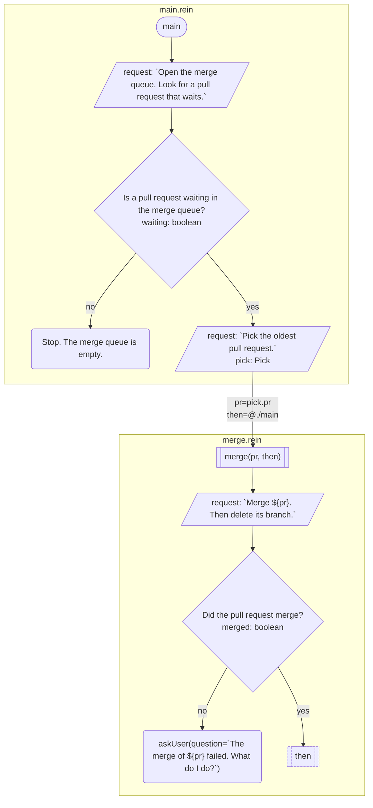

# pr-queue

A merge queue agent program. It merges the pull requests in a queue, one at a time. It shows a callback: a function that the caller passes, so the callee goes on to it when its work is done.

`main` picks a pull request and hands it to `merge` with `then=@./main`. `merge` does not know who called it. After the merge, it returns `then`, so the flow goes back to `main` for the next pull request.

## Files

| File | Function | Job |
| --- | --- | --- |
| `main.rein` | `main` | Entry point. Stops when the queue is empty. Picks the next pull request. |
| `merge.rein` | `merge` | Merges one pull request, then returns its callback `then`. |

## Run it

```sh
git clone https://github.com/rein-lang/examples
cd examples
rein check rein/pr-queue
rein step --root rein/pr-queue --json
```

## Graph

The decision flow, from `rein graph pr-queue`:



## Source

### `package.json`

```json
{
  "name": "pr-queue",
  "version": "0.1.0",
  "description": "Merge the pull requests in a queue, one at a time. Shows a callback.",
  "license": "MIT",
  "private": true,
  "files": ["**/*.rein", "README.md", "rein.json"],
  "engines": {
    "rein": "^0.1.0"
  }
}
```

### `rein.json`

```json
{
  "entry": "main.rein"
}
```

### `main.rein`

```rein
interface Pick {
  /** The link of the pull request to merge next. */
  pr: string;
}

/**
 * Merge the pull requests in the queue, one at a time.
 */
export default async function main() {
  /** Is a pull request waiting in the merge queue? */
  const waiting: boolean = await request(
    `Open the merge queue. Look for a pull request that waits.`,
  );
  if (!waiting) {
    return `Stop. The merge queue is empty.`;
  }
  /** The next pull request in the queue. */
  const pick: Pick = await request(`Pick the oldest pull request.`);
  return @./merge(pr=pick.pr, then=@./main);
}
```

### `merge.rein`

```rein
interface Input {
  /** The link of the pull request to merge. */
  pr: string;
  /** Where the flow goes after the merge. */
  then: @;
}

/**
 * Merge one pull request, then go on to the callback.
 */
export default async function merge({ pr, then }: Input) {
  /** Did the pull request merge? */
  const merged: boolean = await request(
    `Merge ${pr}. Then delete its branch.`,
  );
  if (!merged) {
    return askUser(question=`The merge of ${pr} failed. What do I do?`);
  }
  return then;
}
```
