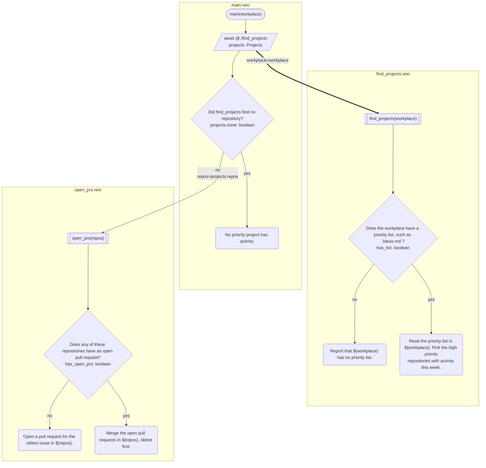

<!--@include: ../../../examples/rein/priority-work/README.md-->

## Graph

The decision flow, from `rein graph priority-work`:

## Source

### `package.json`

<<< ../../../examples/rein/priority-work/package.json{json}

### `rein.json`

<<< ../../../examples/rein/priority-work/rein.json{json}

### `main.rein`

<<< ../../../examples/rein/priority-work/main.rein{rein}

### `find_projects.rein`

<<< ../../../examples/rein/priority-work/find_projects.rein{rein}

### `open_prs.rein`

<<< ../../../examples/rein/priority-work/open_prs.rein{rein}
