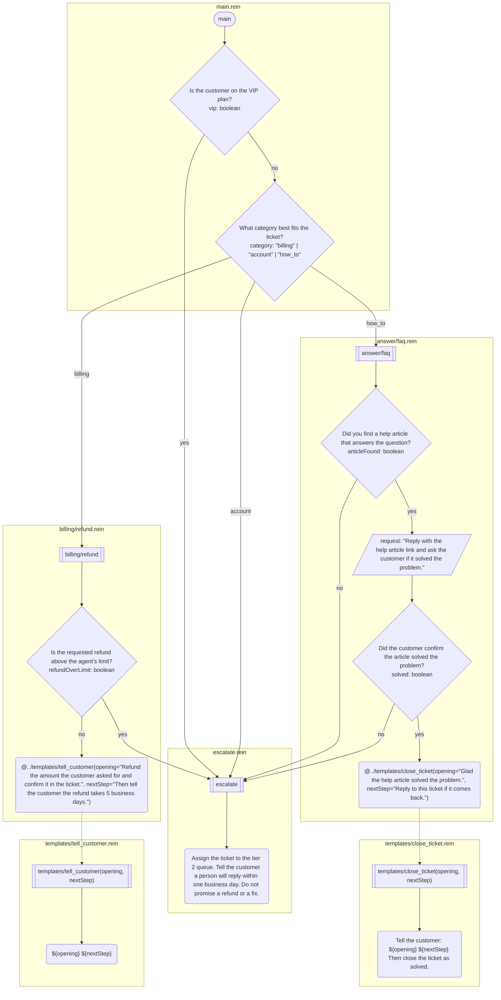

<!--@include: ../../../examples/rein/support-ticket/README.md-->

## Graph

The decision flow, from `rein graph support-ticket`:

## Source

### `package.json`

<<< ../../../examples/rein/support-ticket/package.json{json}

### `rein.json`

<<< ../../../examples/rein/support-ticket/rein.json{json}

### `main.rein`

<<< ../../../examples/rein/support-ticket/main.rein{rein}

### `answer/faq.rein`

<<< ../../../examples/rein/support-ticket/answer/faq.rein{rein}

### `billing/refund.rein`

<<< ../../../examples/rein/support-ticket/billing/refund.rein{rein}

### `escalate.rein`

<<< ../../../examples/rein/support-ticket/escalate.rein{rein}

### `templates/close_ticket.rein`

<<< ../../../examples/rein/support-ticket/templates/close_ticket.rein{rein}

### `templates/message.struct.rein`

<<< ../../../examples/rein/support-ticket/templates/message.struct.rein{rein}

### `templates/tell_customer.rein`

<<< ../../../examples/rein/support-ticket/templates/tell_customer.rein{rein}
