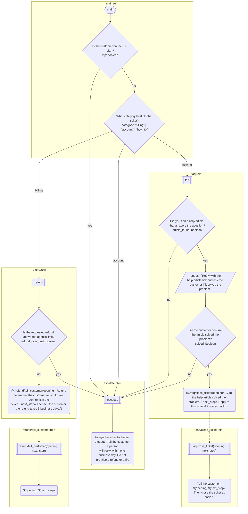

# support-ticket

A customer support agent process. It decides how to answer a customer ticket.

The process routes VIP customers to a human first. Other tickets follow their category. Billing tickets can end in a refund. How-to tickets get a help article when one matches. The agent answers whether the article solved the problem, then the process closes the ticket or escalates it.

## Files

| File | Function | Job |
| --- | --- | --- |
| `main.rein` | `main` | Entry point. Routes by VIP status and category. |
| `refund.rein` | `refund` | Refunds within the agent limit. Escalates larger refunds. |
| `faq.rein` | `faq` | Answers how-to questions from the help center. |
| `escalate.rein` | `escalate` | Hands the ticket to a human engineer. |
| `refund/tell_customer.rein` | `refund/tell_customer` | A template: one sentence for the customer. `refund` calls it. |
| `message.struct.rein` | `Message` | A shared struct. It is the input of both templates. |
| `faq/close_ticket.rein` | `faq/close_ticket` | A template: a last message, then close the ticket. `faq` calls it. |

## Run it

```sh
git clone https://github.com/rein-lang/examples
cd examples
rein check rein/support-ticket
rein run support-ticket
```

## Graph

The decision graph, from `rein graph support-ticket`:



## Source

### `package.json`

```json
{
  "name": "support-ticket",
  "version": "0.1.0",
  "description": "Decide how the support agent handles a customer ticket.",
  "license": "MIT",
  "private": true,
  "files": ["**/*.rein", "README.md", "rein.json"],
  "engines": {
    "rein": "^0.1.0"
  }
}
```

### `rein.json`

```json
{
  "entry": "main.rein"
}
```

### `main.rein`

```rein
interface Ticket {
  /** What category best fits the ticket? */
  category: "billing" | "account" | "how_to";
  /** Is the customer on the VIP plan? */
  vip: boolean;
}

/**
 * Decide how the support agent handles a customer ticket.
 */
export default function main({ category, vip }: Ticket) {
  if (vip) {
    return @./escalate;
  }

  switch (category) {
    case "billing":
      return @./refund;
    case "account":
      return @./escalate;
    case "how_to":
      return @./faq;
  }
}
```

### `escalate.rein`

```rein
/**
 * Hand the ticket to a human support engineer.
 */
export default function escalate() {
  return `Assign the ticket to the tier 2 queue. Tell the customer a person
  will reply within one business day. Do not promise a refund or a fix.`;
}
```

### `faq.rein`

```rein
/**
 * Answer a how-to question from the help center.
 */
export default async function answerFaq(
  /** Did you find a help article that answers the question? */
  article_found: boolean,
) {
  if (!article_found) {
    return @./escalate;
  }

  /** Did the customer confirm the article solved the problem? */
  const solved: boolean = await request(
    `Reply with the help article link and ask the customer if it solved the
    problem.`,
  );

  if (solved) {
    return @./faq/close_ticket(
      opening=`Glad the help article solved the problem.`,
      next_step=`Reply to this ticket if it comes back.`,
    );
  }

  return @./escalate;
}
```

### `faq/close_ticket.rein`

```rein
/**
 * Send the customer a last message, then close the ticket.
 */
export default function closeTicket({ opening, next_step }: @../message) {
  return `Tell the customer: ${opening} ${next_step} Then close the ticket as
  solved.`;
}
```

### `message.struct.rein`

```rein
/**
 * One sentence for the customer: what happened, then what comes next.
 */
export default interface Message {
  /** The first part of the sentence, such as the action taken. */
  opening: string;
  /** The next step the customer can expect. */
  next_step: string;
}
```

### `refund.rein`

```rein
/**
 * Process a refund request from a billing ticket.
 */
export default function refund(
  /** Is the requested refund above the agent's limit? */
  refund_over_limit: boolean,
) {
  if (refund_over_limit) {
    return @./escalate;
  }

  return @./refund/tell_customer(
    opening=`Refund the amount the customer asked for and confirm it in the
    ticket.`,
    next_step=`Then tell the customer the refund takes 5 business days.`,
  );
}
```

### `refund/tell_customer.rein`

```rein
/**
 * Tell the customer what happens next, in one sentence.
 */
export default function tellCustomer({ opening, next_step }: @../message) {
  return `${opening} ${next_step}`;
}
```
