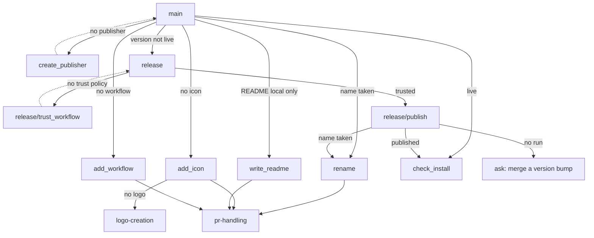

# vscode-extension

A published program that ships a VS Code extension that already works. It does not write extension code. It lives in its own repo, [rein-lang/vscode-extension](https://github.com/rein-lang/vscode-extension).

The program shipped the [Rein extension](https://marketplace.visualstudio.com/items?itemName=rein-lang.rein-language) the same way: it renamed the extension when the Marketplace said `rein` was taken, added a workflow that publishes when a version bump merges, and found an old local copy that stopped the new one from starting.

Each run reads the repo and the Marketplace, then does the first missing step. Run it again after each step.

## Files

| File | Function | Job |
| --- | --- | --- |
| `main.rein` | `main` | Entry point. `scripts/read-state.sh` reads the state; the first missing step runs. |
| `rename.rein` | `rename` | The user picks a free name. Marketplace names are unique across all publishers. |
| `create_publisher.rein` | `create_publisher` | The user signs in. The agent creates the publisher, or uses one the user owns. |
| `add_icon.rein` | `add_icon` | `scripts/make-icon.sh` makes a 256 px icon from the project logo. No logo hands off to `logo-creation`. |
| `write_readme.rein` | `write_readme` | The README Install section leads with the Marketplace. |
| `add_workflow.rein` | `add_workflow` | `scripts/add-workflow.sh` adds a workflow that publishes on a merge to `main` with trusted publishing. |
| `release.rein` | `release` | Checks the trust policy. The merge of a version bump is the release. |
| `release/trust_workflow.rein` | `release/trust_workflow` | After the user approves, creates the Marketplace trust policy for the workflow. |
| `release/publish.rein` | `release/publish` | `scripts/watch-publish.sh` waits for the publish run of the merge and reports the result. |
| `check_install.rein` | `check_install` | `scripts/check-install.sh` installs from the Marketplace and reads the VS Code log. |

## What it shows

- **A resumable process.** `main` reads the state each run, so one program covers many sessions and pull requests. Each code change is one pull request handed to `pr-handling`.
- **One script for the whole state.** `read-state.sh` prints the `State` struct as JSON. The `if` chain in `main` holds the order of the steps, not a prompt.
- **Hand-offs to other programs.** `add_icon` hands off to `logo-creation`, and the code steps to `pr-handling`. Both are `peerDependencies` in `package.json`.
- **The user approves account steps; git approves releases.** Creating a publisher and the trust policy wait for a typed yes. A release goes public only through a merged pull request; the program never pushes a tag.
- **A failure picks its fix.** `release/publish` maps the run result to a step: a taken name goes back to `rename`.
- **Names.** `release/trust_workflow` and `release/publish` have one caller, so they sit in `release/`, and call back with `import { release } from "../release";`. See [Project layout](/reference/spec#_1-project-layout).

## Run it

```sh
rein install -g "github:rein-lang/vscode-extension#<commit sha>"
rein step --flow vscode-extension --input repo=<path to the extension repo> --json
```

The scripts need `gh`, `jq`, `curl`, `git`, `code` and `rsvg-convert`.

## Graph



## Source

The source lives in [rein-lang/vscode-extension](https://github.com/rein-lang/vscode-extension). This page does not copy it, so it cannot drift.
