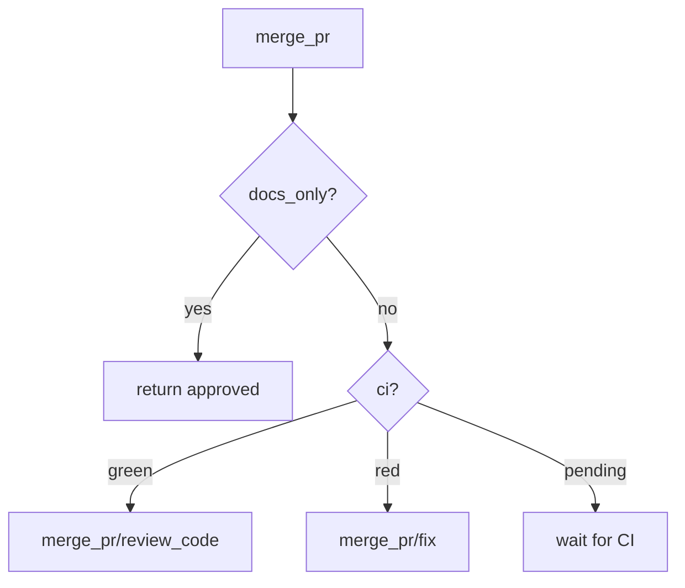

# Rein

Status: proof of concept. Syntax can still change.

Give your agent apps, not manuals. A Rein program opens for the agent, asks one question, and waits for the answer. Then it gives the next step. The agent cannot skip a step, and the program keeps track of where the agent is. The same answers lead to the same step, for every agent and every run.

Install a program like an app, and your agent opens it when a task matches. Use `rein watch` to see each run, its answers, and the step it waits on. Do you use skills today? A skill is a manual. A program is an app. See [Skills and programs](/rein-vs-skills) for the difference.

Rein programs are written in Rein, a small language. Rein mimics TypeScript syntax and types. It uses named imports, as TypeScript does. There is no `else`, and no `default`. Every function returns on every path. A function takes one parameter: a scalar or a struct, and a shared struct is a `<name>.struct.rein` file.

## Sample

`examples/rein/merge-pr/merge_pr.rein`:

```ts
// merge_pr.rein

import { review_code } from "./merge_pr/review_code";
import { fix } from "./merge_pr/fix";

interface Input {
  /** Does the PR change only documentation files? */
  docs_only: boolean;
  /** What is the CI status of the PR? */
  ci: "green" | "red" | "pending";
}

/**
 * Decide whether a pull request can be merged.
 */
export default function mergePr({ docs_only, ci }: Input) {
  if (docs_only) {
    return `approved`;
  }

  switch (ci) {
    case "green":
      return review_code;
    case "red":
      return fix;
    case "pending":
      return `wait for CI, then run merge_pr again`;
  }
}
```



## How an agent uses it

The agent runs the program with `rein step`. The runtime keeps no state, so each call takes every answer so far. Each call returns one of four kinds: `question`, `request`, `done`, or `error`. The walk below runs `examples/rein/support-ticket`. Each line after `$` is one call. `# exit` is its exit code:

```text
$ cd examples/rein/support-ticket
$ rein step --json
{"kind":"question","version":1,"key":"main.vip","function":"main","name":"vip","type":"boolean","options":null,"description":"Is the customer on the VIP plan?","answers":{},"trace":["main"]}
# exit 2

$ rein step --json --answer main.vip=no
{"kind":"question","version":1,"key":"main.category","function":"main","name":"category","type":"union","options":["billing","account","how_to"],"description":"What category best fits the ticket?","answers":{"main.vip":"no"},"trace":["main"]}
# exit 2

$ rein step --json --answer main.vip=no --answer main.category=how_to
{"kind":"question","version":1,"key":"faq.article_found","function":"faq","name":"article_found","type":"boolean","options":null,"description":"Did you find a help article that answers the question?","answers":{"main.category":"how_to","main.vip":"no"},"trace":["main","faq"]}
# exit 2

$ rein step --json --answer main.vip=no --answer main.category=how_to --answer faq.article_found=yes
{"kind":"request","version":1,"key":"faq.solved","function":"faq","instruction":"Reply with the help article link and ask the customer if it solved the problem.","response":{"name":"solved","type":"boolean","options":null,"description":"Did the customer confirm the article solved the problem?"},"answers":{"faq.article_found":"yes","main.category":"how_to","main.vip":"no"},"trace":["main","faq"]}
# exit 3

$ rein step --json --answer main.vip=no --answer main.category=how_to --answer faq.article_found=yes --answer faq.solved=yes
{"kind":"done","version":1,"instruction":"Close the ticket as solved.","answers":{"faq.article_found":"yes","faq.solved":"yes","main.category":"how_to","main.vip":"no"},"trace":["main","faq"]}
# exit 0
```

A call follows each reference in the same call. The `trace` lists the functions it visited. For a `question` or a `request`, the agent asks the user or does the step, adds the key to its answers, and steps again. Without `--json`, `rein step` prints plain text. `rein eval` evaluates one function, for debugging. The protocol and exit codes are in [spec section 11](/reference/spec#_11-stepping-agent-interface).

## Quickstart

```sh
cargo install --git https://github.com/rein-lang/rein --tag v0.1.5 --locked rein  # puts `rein` on PATH
git clone https://github.com/rein-lang/examples
cd examples
rein list                               # the programs visible from here
rein run support-ticket                 # run one program by name, answer on stdin
rein graph support-ticket               # its decision graph as Mermaid (--format dot|json, -o graph.svg)
rein serve --mcp                        # the MCP host for agents
rein watch                              # a page of the agents that use rein now
```

Check an example:

```sh
rein check rein/merge-pr
```

Examples: [merge-pr](/examples/merge-pr), [incident-triage](/examples/incident-triage), [support-ticket](/examples/support-ticket), [pr-handling](/examples/pr-handling), [priority-work](/examples/priority-work).

## Next steps

- [Getting started](/getting-started): install the CLI and write a first program.
- [Install a program](/install-programs): install, list, update, or remove a program.
- [Concepts](/concepts): the model in one page.
- [Skills and programs](/rein-vs-skills): when to write a manual and when to write an app.
- [Editor](/editor): the VS Code extension.
- [Language reference](/reference/spec): syntax, rules, evaluation, CLI.
- [Decisions](/reference/decisions): owner facts, PoC choices, open questions.
- [Agent interface](/reference/interface): programs as named apps, the MCP host, and `rein run`.

## License

MIT. See [LICENSE](LICENSE).
