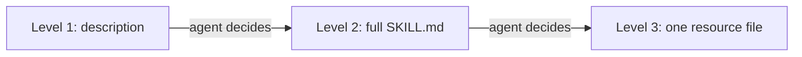
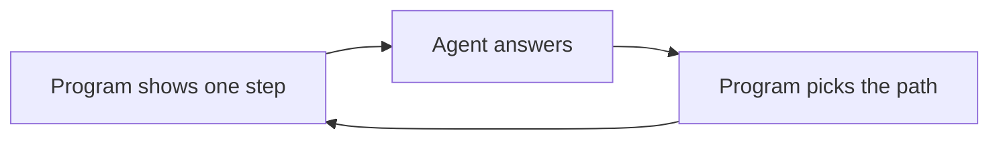

# Progressive disclosure

Progressive disclosure is a rule from interface design: show the important part first, and show the rest on request. Jakob Nielsen described it in 2006 as a way to make an application easier to learn and to cause fewer errors.

An agent needs the same rule. Its context is limited. Text that the agent does not need now uses space, and it makes the important text harder to follow.

Skills and Rein programs both use progressive disclosure. They differ in two things:

- **The unit.** A skill shows a file. A Rein program shows a step.
- **Who decides.** With a skill, the agent decides what to open. With Rein, the program decides what to show.

This page shows where the skill model stops, and what Rein does there. It does not say that skills are bad. For knowledge, a skill is still the more suitable tool. See [Rein and skills](/rein-vs-skills).

## How a skill discloses

The Agent Skills specification gives three levels:

| Level | What loads | When |
| --- | --- | --- |
| 1. Metadata | The `name` and the `description`, about 100 tokens | At startup, for each installed skill |
| 2. Instructions | The full `SKILL.md` body, less than 5000 tokens recommended | When the agent activates the skill |
| 3. Resources | Scripts, references and assets | When the agent decides that it needs them |

This is a good design for knowledge. One hundred skills cost only their descriptions until the agent needs one.



Each arrow is a decision of the agent. That is where the limits come from.

## Where the skill model stops

### 1. The agent decides if the skill loads

Only the description is in context at the start. The Agent Skills guide says that the description "carries the entire burden of triggering". The guide also says that the same query can trigger the skill on one run and not on the next run.

Measurements show the result:

- Vercel ran agent evals with a skill for its framework docs. It reported: "In 56% of eval cases, the skill was never invoked." The pass rate with the skill was the same as with no docs.
- Tessl reported an activation rate of 41% when the agent was not forced to use the skill. The post gives few details of the method.

Your setup can give other numbers. The cause stays the same: the agent can do the task without the skill, and no one stops it.

### 2. Level 2 loads all at once

The specification says: "the agent will load this entire file once it's decided to activate a skill". A procedure with five branches puts all five in context. The agent needs one.

So the disclosure stops at the file. Inside the file, there are no more levels.

### 3. The agent decides again for each resource

A good skill moves details to reference files. Then the agent must decide to open the right file at the right time. This is the decision of limit 1 again, in a smaller size. An agent that does not open the file works without the details.

### 4. No level gives the next step

After the body loads, the skill does nothing more. The order of the steps lives in a text that the agent read some time ago. The agent must remember where it is.

A long run makes this harder. Chroma tested 18 models and found that "performance grows increasingly unreliable as input length grows". Each tool result makes the context longer, and the skill text moves farther back.

## How a Rein program discloses

A Rein program does not give the agent a file. It gives one question or one instruction. The next one comes only after the agent answers.



Nielsen has a name for this variant: staged disclosure, where the user goes through a sequence of steps, as in a wizard. Rein is staged disclosure for agents, with branches.

This is a walk through the `support-ticket` example. Each line is all that the agent gets at that step:

```text
question: main.vip: boolean - Is the customer on the VIP plan?
question: main.category: "billing" | "account" | "how_to" - What category best fits the ticket?
question: faq.article_found: boolean - Did you find a help article that answers the question?
request: Reply with the help article link and ask the customer if it solved the problem.
```

The program also has a refund path and an escalation path. On this walk, the agent never sees them.

The four limits change like this:

| Limit of the skill model | What Rein does |
| --- | --- |
| The agent decides if the skill loads. | Inside a run, nothing loads on a decision of the agent. The program shows the step. |
| The body loads all at once. | The unit is one step. The program asks for an input only when the taken path needs it. |
| The agent decides again for each resource. | A path that is not taken is never shown. The agent does not choose what to read. |
| No level gives the next step. | Each answer returns the next step. The newest text in context is always the current step. |

The disclosure is also the same on each run. The same answers give the same steps, because code picks the path.

## What Rein does not solve

Rein has limits too:

- **The start.** An agent finds a program by its name and its description, the same as level 1 of a skill. Someone must start the run: the agent, the user, or a hook. A trigger that starts a program before a guarded action is a proposal, and it is not built. See [Agent interface](/reference/interface).
- **The answers.** The program picks the path from the answers of the agent. A wrong answer leads to a wrong path. The trace shows each answer, so you can find it.
- **Knowledge.** A step can need knowledge, such as how to review code. Rein does not hold that knowledge. A skill does, and a step can name the skill.

## Which one to use

- The agent needs to **know** something: use a skill. Three levels are enough for knowledge.
- The agent needs to **do steps in order**: use a Rein program. It discloses down to one step.
- A task needs both: let the program give the steps, and let a step name a skill.

To try it, see [Getting started](/getting-started).

## Sources

- [Agent Skills specification: Progressive disclosure](https://agentskills.io/specification#progressive-disclosure). The three levels and the full-body load.
- [Agent Skills: Optimizing skill descriptions](https://agentskills.io/skill-creation/optimizing-descriptions). How triggering works and why it differs between runs.
- [AGENTS.md outperforms skills in our agent evals](https://vercel.com/blog/agents-md-outperforms-skills-in-our-agent-evals), Jude Gao, Vercel, 2026-01-27.
- [Common pitfalls of skills development and how to fix them](https://tessl.io/blog/common-pitfalls-of-skills-development-and-how-to-fix-them), Alan Pope, Tessl, 2026-04-28.
- [Context Rot](https://www.trychroma.com/research/context-rot), Kelly Hong, Anton Troynikov and Jeff Huber, Chroma, 2025-07-14.
- [Progressive Disclosure](https://www.nngroup.com/articles/progressive-disclosure/), Jakob Nielsen, Nielsen Norman Group, 2006-12-03.
