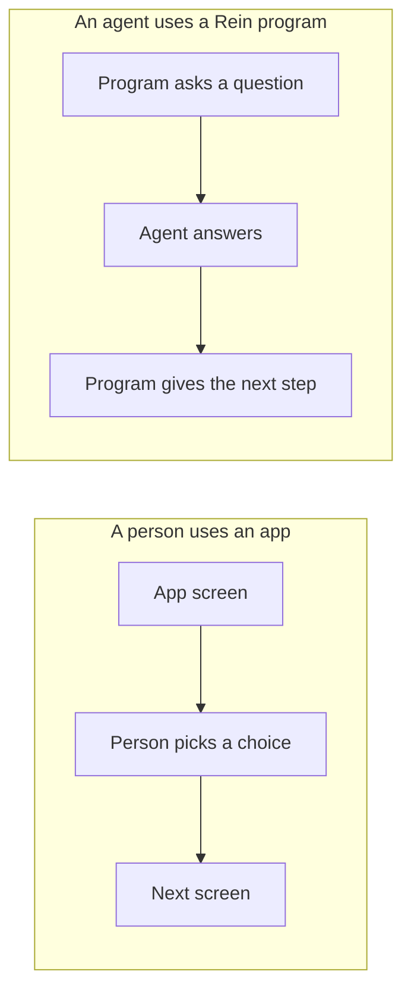
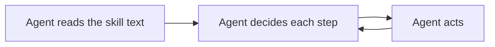
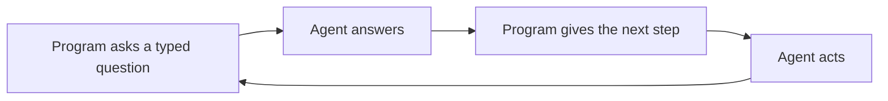

# Skills are manuals, programs are apps

A skill is a manual. It is a folder with a `SKILL.md` file. The agent reads all of it, then decides each step itself.

A Rein program is an app for the agent. The agent opens it. The program asks one question, the agent answers, and the program gives the next step. The agent cannot skip a step.

Use both. Knowledge goes to skills. Steps and decisions go to programs. A program can also name a skill for one step.



## The difference

With a skill, the agent reads the text, then decides each step itself:



With a Rein program, the program decides the next step from the agent's answers:



| | Skill (manual) | Rein program (app) |
| --- | --- | --- |
| What it is | Text in Markdown. It can bundle scripts and files. | Small typed functions, one per file. |
| Who decides the next step | The agent, from the text. | The program, from the agent's answers. |
| What the agent reads | The full text, when the skill loads. | One question or one instruction at a time. |
| What is checked before a run | The text has no checker. | The checker finds a missing case, or a path with no result. |
| How you see a run | Read the conversation. | Read the trace, the graph, or the debugger. |
| How it changes | Edit the text and test it with an agent. | Edit the code. The checker shows each place that needs a new case. |
| How you share it | Copy the folder. | Install an npm package with a version. |

For how each one gives the agent its text, see [Progressive disclosure](/progressive-disclosure).

For why a program is not written in TypeScript or Python, see [Why not an existing language](/why-not-a-programming-language).

## Use a skill for knowledge

A skill is the more suitable tool when the agent needs to know something:

- **Conventions.** Your code style, your naming rules, the tone of your messages.
- **Tool knowledge.** How to call an API, how to use a command line tool, where the files are.
- **Open tasks.** Writing, design, and research. No one can list the steps before the work starts.
- **Short procedures.** A few steps with no branches.
- **A new process.** You do not know the cases yet. Write the text first and learn from the runs.

## Use a Rein program for steps and decisions

A Rein program is the more suitable tool when the work has an order, and the order matters:

- **Branches.** Handle a pull request, triage an incident, answer a support ticket. Each answer leads to a different step.
- **Steps that the agent must not skip.** The agent gets the next step only after it answers the current one.
- **Long work.** An agent can lose track of a long text. A program gives it one step, then the next step.
- **Decisions for a person.** The program sends a request, waits, and branches on a typed answer.
- **Work that repeats.** The same answers always lead to the same step, for each agent and each run.
- **Work that changes.** Add an option to an input. The checker reports each place that needs a case for it.
- **Work in parts.** One program hands off to another program. Each program stays small.

## Signs that a skill needs a program

You have a skill, and one of these is true:

- The text says "if", "unless", or "otherwise" many times.
- The text says "IMPORTANT" or "never skip this step".
- The agent did all the steps yesterday and skipped one today.
- The text becomes longer after each mistake.
- After a run, you cannot tell which path the agent took.

Then move the decisions to a Rein program. Keep the knowledge in the skill.

## The same task, both ways

This skill, a manual, tells the agent how to handle a pull request:

```md
# Handle a pull request

If the PR changes only documentation, merge it.
Otherwise, look at CI. If CI is green, review the code.
If CI is red, fix the failing check. If CI is pending, wait.
IMPORTANT: never merge when CI is red.
```

The agent reads all of it and applies the rules itself. That is fast to write, and it works for a small task.

This Rein program, an app, makes the same decisions:

```rein
interface Input {
  /** Does the PR change only documentation files? */
  docs_only: boolean;
  /** What is the CI status of the PR? */
  ci: "green" | "red" | "pending";
}

/**
 * Decide the next step for a pull request.
 */
export default function main({ docs_only, ci }: Input) {
  if (docs_only) {
    return `Merge the PR.`;
  }

  switch (ci) {
    case "green":
      return `Review the code. Use the code-review skill.`;
    case "red":
      return `Fix the failing check, then run this program again.`;
    case "pending":
      return `Wait for CI, then run this program again.`;
  }
}
```

The program asks the two questions, one at a time. The agent answers them and gets one instruction:

```json
{"kind":"done","version":1,"instruction":"Review the code. Use the code-review skill.","answers":{"main.ci":"green","main.docs_only":"no"},"trace":["main"]}
```

The program needs no "IMPORTANT" line. No path leads from a red CI to a merge.

Now CI gets a fourth status, `cancelled`. In the skill, you must remember to edit the text. In the program, add `"cancelled"` to the `ci` type and run `rein check`. The checker reports the missing case:

```text
error: switch on `ci` needs a case for every member; missing: `cancelled`
error: every path must return something; end the function with a return
```

## Use them together

Skills and programs work well in one project. The rule is: decisions go to programs, knowledge goes to skills.

- **A step names a skill.** The program above returns `Review the code. Use the code-review skill.` The program decides when to review. The skill knows how to review.
- **A skill starts a program.** A skill can tell the agent which program to open for a task. The skill is the entry point, and the program gives the steps.

You do not need to replace your skills. Start with one skill that has many branches.

## Try it

1. Install the CLI. See [Getting started](/getting-started).
2. Run an example to see how a program feels. See [support-ticket](/examples/support-ticket).
3. Take one skill that has branches. Write each "if" as a typed input, as in the program above.
4. Run `rein check` on the program. Then open it with `rein debug` and try each path.
5. Connect your agent with `rein serve --mcp`. See [Agent interface](/reference/interface).

The first program takes a few minutes. After that, each run of the task follows the same steps.
