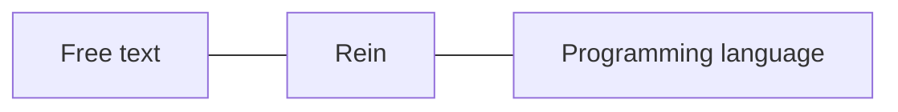

# Why not an existing language

Rein looks like TypeScript. So the question is fair: why not write agent processes in TypeScript, or in Python?

The answer is in what a process is. A process does not compute. It decides. The agent does the work, and the process tells the agent the next step.

- A programming language handles **logic**: data, loops, calculations, input and output.
- Free text handles **decisions** badly: the agent must find the branches in the prose.
- Rein handles **decision trees**, and only decision trees.

Rein does not try to be a better programming language. It has less than one on purpose.

## Three ways to write a decision



| | Free text | Rein | Programming language |
| --- | --- | --- | --- |
| Made for | Knowledge | Decision trees | Logic |
| A branch is | A sentence with "if" | A typed case | Code |
| A missing case | No one sees it | The checker reports it | Only some compilers report it, and only if you ask |
| All paths are known before a run | No | Yes | No |
| A question to the agent | A sentence | A typed parameter | Code that you write |
| What it can do on your machine | Nothing | Nothing | All that your user account can do |

Free text is too loose for a decision. A programming language is too large for it. Rein is the part between them.

## What a process needs

A decision tree needs five things:

1. A question, with a type for the answer.
2. A branch on the answer.
3. An instruction for the agent.
4. A hand-off to another part of the tree.
5. A step that waits for the agent or for a person.

That is the full list. Rein has these five things, and each one is part of the language:

```rein
import { review_code } from "./review_code";
import { fix } from "./fix";

interface Input {
  /** Does the PR change only documentation files? */
  docs_only: boolean;
  /** What is the CI status of the PR? */
  ci: "green" | "red" | "pending";
}

/**
 * Decide the next step for a pull request.
 */
export default function main({ docs_only, ci }: Input) {
  if (docs_only) {
    return `Merge the PR.`;
  }

  switch (ci) {
    case "green":
      return review_code;
    case "red":
      return fix;
    case "pending":
      return `Wait for CI, then run this process again.`;
  }
}
```

The same tree as text:

```text
merge-pr
├── docs_only: yes ──> Merge the PR.
└── docs_only: no
    └── ci ?
        ├── green   ──> review_code
        ├── red     ──> fix
        └── pending ──> Wait for CI, then run this process again.
```

The code and the tree have the same shape. That is the goal: you read the file, and you see the tree.

## What Rein leaves out

A general language has much more than those five things. Rein refuses each of them, and the checker says so:

```text
error: Rein has no loops yet
error: Rein has no variables
error: `import *` is not supported; write `import { name } from "path";`
error: Rein has no `else`: end the `if` block with a return, and handle the other case after it
```

Rein also has no arithmetic, no network calls and no file access. A function returns text, a reference, or a request. It cannot do anything else.

Each missing feature is a decision, not a gap. Each one buys a property that a general language cannot promise.

## What the small size buys

### The full tree is known before a run

A function has no loops and no variables, so each path through it has an end. The checker follows each path and reports a path with no result. In a general language, no tool can do this for all programs.

Because the tree is known, Rein can show it. `rein graph` draws it. `rein debug` walks it. You see each path before an agent runs one.

### Each case has an answer

A `switch` needs a case for each member of the type. There is no `default` and no `else`, so no case hides in a fallback. Add a fourth CI status, and the checker reports each place that needs it:

```text
error: switch on `ci` needs a case for every member; missing: `cancelled`
```

Some languages can do this check. You must turn it on, and one `default` turns it off again.

### A question is part of the language

In Rein, a parameter is a question. Its doc comment is the question text. Its type is the set of answers. Rein asks for it only when the taken path needs it.

In a general language, you write this part yourself: a way to ask, a way to wait, a way to check the answer, and a way to continue. That is a framework, and each team writes a different one.

### A run can stop and continue

A function has no side effects. So the answers so far are the full state of a run. Give the same answers again, and the run is at the same step. A process can wait an hour for a person, and nothing stays open on your machine.

A general program holds its state in memory. To stop it and continue later, you must save that state yourself.

### A program from another person is safe to read and run

A Rein function cannot read a file, call a network, or run a command. The worst result of a bad program is a bad instruction, and the agent and the user see that instruction as text.

A TypeScript or Python program can do all that your user account can do. You must review it or put it in a sandbox before you run it.

### An agent can write it

The grammar is small, and each error names the fix. An agent writes a process, runs `rein check`, and corrects it. There are few ways to write one decision, so two processes for the same task look the same.

## Why the TypeScript syntax

Rein takes the syntax and the types of TypeScript, because many people can read them at first sight. A union such as `"green" | "red"` is a good way to write a choice.

Rein takes only the syntax. A Rein file is not a TypeScript file, and it does not run in a TypeScript runtime.

## When you need logic

Some steps need real logic: parse a file, call an API, calculate a number. Do not put that in Rein. Write a script in the language that fits, and let a step tell the agent to run it.

The [logo-creation](/examples/logo-creation) example does this. A script checks the drawings. The agent runs the script and answers one typed question: valid, or not valid. The process branches on the answer.

So the split is:

```text
your task
├── knowledge   ──> a skill
├── a decision  ──> a Rein process
└── logic       ──> a script, in a language that fits
```

The three work together. The process gives the order. A step names the skill or the script.

## Limits

- Rein has no loops yet. A retry is a reference back to an earlier function, and the checker warns about such a cycle.
- A tree that needs a calculation inside a branch does not fit. Move the calculation to a script.
- The reasons for each rule are in [Decisions](/reference/decisions).

## Read next

- [Rein and skills](/rein-vs-skills): Rein compared with free text.
- [Progressive disclosure](/progressive-disclosure): how the agent gets one step at a time.
- [Getting started](/getting-started): write a first process.
